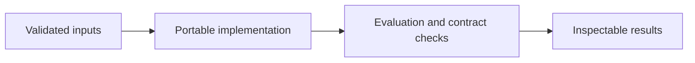

# Budget Classification and Fairness Analysis

**Feras Elghandour** · Technical case study

Evaluate how a binary budget recommendation trades predictive accuracy against differences in outcomes across education cohorts.

## Implementation

A reusable fairness core computing confusion counts, group outcome gaps, and reweighing weights with explicit undefined-rate handling.



## Completed study

Saved test results show baseline accuracy 0.9976 and reweighed logistic-regression accuracy 0.9769. Equal-opportunity difference changes from −1.0000 to 0.0195 and average-odds difference from −0.5278 to −0.0014. Statistical parity remains poor (−0.9328); the model is not universally fair.

These historical figures describe the completed study. This refactored standalone implementation has separate validation and has not been used to recertify the historical benchmark. The public release contains the portable core and focused tests.

## Run locally

Python 3.11 or later.

```sh
python -m venv .venv
source .venv/bin/activate
python -m pip install -r requirements.txt
python smoke_test.py
python fairness.py /path/to/predictions.csv
```

Prepare your own inputs as described in [DATA.md](DATA.md). Tests use generated fixtures and do not need credentials or provider calls. [VALIDATION.md](VALIDATION.md) records their scope.

## Practical relevance and limitations

The target is budget at least $300, not an exact-dollar forecast. The observed fairness trade-offs apply to this synthetic dataset and group definitions. Strong remaining demographic parity gaps require further work before operational use.

This edition makes the core behavior reusable and inspectable. Historical metrics and synthetic contract tests provide different kinds of evidence; neither establishes client deployment or commercial impact.
