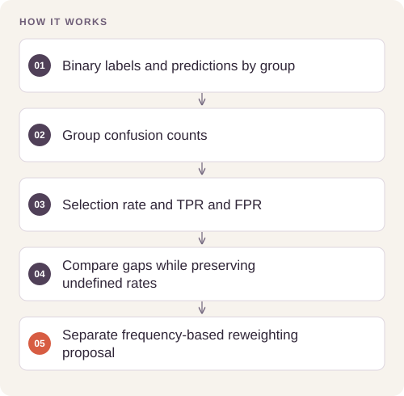

# Budget Classification and Fairness Analysis

Evaluate how a binary budget recommendation trades predictive accuracy against differences in outcomes across education cohorts.

## Implementation

A reusable fairness core computing confusion counts, group outcome gaps, and reweighing weights with explicit undefined-rate handling.




## Reproduce and inspect

The executable reproduction profile now records exact commands, input/source hashes, dependency versions, logs and pass/fail status. Its scope distinguishes behavior checks from full-data benchmarks.

[Commands, artifacts and benchmark scope](BENCHMARKS.md) · [Versioned profiles](reproduction.json)


## Try a small example

A small offline fixture exercises the public implementation. It demonstrates the behavior shown below; it does not replace the historical dataset, benchmark or production validation.

After the local setup below, run from the repository root:

```sh
python examples/quickstart.py
```

The [example source](examples/quickstart.py), [captured output](examples/expected-output.txt) and [execution record](examples/environment.json) keep this demonstration inspectable. Floating-point values may vary with library versions.

Observed output from this run:

```text
{
  "metrics": {
    "tp": 4,
    "tn": 4,
    "fp": 0,
    "fn": 0,
    "accuracy": 1.0,
    "statistical_parity_difference": 0.0,
    "disparate_impact": 1.0,
    "equal_opportunity_difference": 0.0,
    "average_odds_difference": 0.0
  },
  "weights": [
    1.0,
    1.0,
    1.0,
    1.0,
    1.0,
    1.0,
    1.0,
    1.0
  ]
}
```

## Completed study

Saved test results show baseline accuracy 0.9976 and reweighed logistic-regression accuracy 0.9769. Equal-opportunity difference changes from −1.0000 to 0.0195 and average-odds difference from −0.5278 to −0.0014. Statistical parity remains poor (−0.9328); the model is not universally fair.

These historical figures describe the completed study. This refactored standalone implementation has separate validation and has not been used to recertify the historical benchmark. The public release contains the portable core and focused tests.

## Run locally

Python 3.11 or later.

```sh
python -m venv .venv
source .venv/bin/activate
python -m pip install -r requirements.txt
python smoke_test.py
python fairness.py /path/to/predictions.csv
```

Prepare your own inputs as described in [DATA.md](DATA.md). Tests use generated fixtures and do not need credentials or provider calls. [VALIDATION.md](VALIDATION.md) records their scope.

## Practical relevance and limitations

The target is budget at least $300, not an exact-dollar forecast. The observed fairness trade-offs apply to this synthetic dataset and group definitions. Strong remaining demographic parity gaps require further work before operational use.

## Reuse

The original contributions listed in [LICENSING.md](LICENSING.md) are available under [MIT](LICENSE). This scoped grant preserves upstream notices and separate dataset, simulator, notebook and checkpoint terms.
